# CCM101 Cloud Computing

# Enterprise Cloud Architect Operational Manual

| Item | Details |
| --- | --- |
| Project | Secure Multi-Tier Web Application |
| Application Stack | WordPress + MySQL |
| Prepared by | ACERIT, SUZETTE; APOLINAR, CYRIEL; CASTILLO, GAMMIE; GODOY, ROSE ANN; TAMAYO, JOSEPHINE |
| Section | BSIT 4 A |
| Instructor | Jenkielyn C. Torres |
| Date | October 2026 |

---


## 1. Project Overview

This manual explains how the secure multi-tier web application was built, deployed, secured, backed up and maintained. The application is WordPress with a MySQL database. Both run as Docker containers inside an Ubuntu Server virtual machine on VirtualBox. The VM is stored on the laptop's internal drive.

Follow the parts in order. Finish and test each part before moving to the next one. Replace YOURUSER with your GitHub username and youruser with the Ubuntu username you created. Keep all passwords private.


### 1.1 Project at a glance

| Item | Choice |
| --- | --- |
| Application stack | WordPress + MySQL |
| Hypervisor | VirtualBox (Type 2) |
| Guest OS | Ubuntu Server 26.04 LTS |
| VM storage | Laptop internal drive (C:\CCM101\VMs) |
| Network | NAT with port forwarding (host 2222 to 22, host 8080 to 80) |
| Security | UFW, default deny, allow 22 and 80 only |
| Automation | Bash backup script plus cron at 11:00 PM |
| Repo folder | Laboratory-10-Enterprise-Cloud-Architect |


### 1.2 Folder layout on the laptop

| Folder | Purpose |
| --- | --- |
| C:\CCM101\ISO | Ubuntu Server ISO |
| C:\CCM101\VMs | ccm101-server and backup-disk.vdi |
| C:\CCM101\Repo | GitHub repo clone |
| C:\CCM101\Screenshots | Proof for the manual |
| C:\CCM101\VM-Backups | Exported .ova copy |


## 2. Infrastructure and Architecture Diagram

The diagram shows the layers from the outside in. Your browser and terminal reach the VM through VirtualBox NAT port forwarding. UFW guards the Ubuntu VM. Docker runs the two containers on a private backend network.

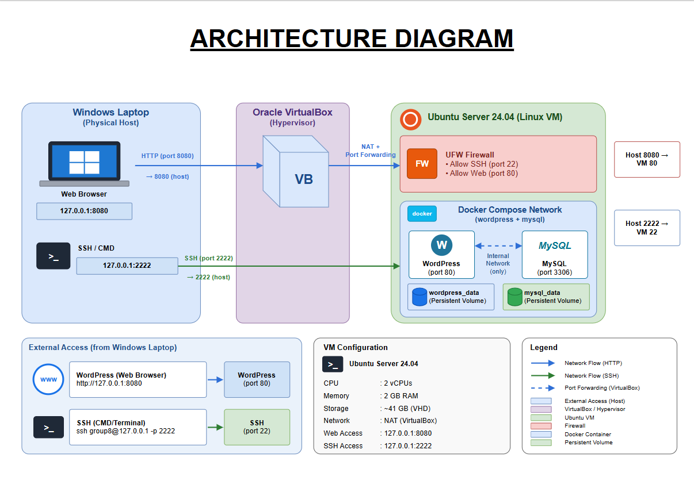

*Figure 1. Architecture diagram*


### 2.1 Layers, outside to inside

| Layer | Role |
| --- | --- |
| Host laptop (Windows 11) | Contains the internal drive and the VirtualBox Type 2 hypervisor. |
| Internal drive (C:) | Holds the VM disk and backup-disk.vdi inside C:\CCM101\VMs. |
| VirtualBox | Runs the Ubuntu Server VM. |
| UFW firewall border | Default deny, allow 22 and 80. |
| Docker | Backend network, containers ccm101-wordpress and ccm101-mysql, and volumes wordpress_data and db_data. |


### 2.2 Traffic paths

| From | To |
| --- | --- |
| Browser at localhost:8080 | VM port 80 (WordPress) |
| Terminal at localhost:2222 | VM port 22 (SSH) |
| Cron script | /mnt/backup (backup disk) |


## 3. Required Resources


### 3.1 Hardware

- Laptop with at least 8 GB of RAM. Give the VM 4 GB, or 3 GB if the laptop is low.
- At least 60 GB free on the C: drive. The 40 GB VM disk and 10 GB backup disk are dynamically allocated, so they start small and grow.
- Virtualization enabled in BIOS (Intel VT-x or AMD SVM Mode).


### 3.2 Software and accounts

| Software | Source and notes |
| --- | --- |
| VirtualBox | virtualbox.org. Keep the defaults and accept driver prompts. |
| Git for Windows | git-scm.com, default options. |
| VS Code | code.visualstudio.com, default options. |
| draw.io | app.diagrams.net in a browser, or the desktop app. |
| Ubuntu Server ISO | ubuntu.com/download/server, LTS version. |
| GitHub account | github.com |
| KillerCoda account | killercoda.com (can sign in with GitHub). |


### 3.3 Virtual machine sizing

| Setting | Value |
| --- | --- |
| Name | ccm101-server |
| Type and version | Linux, Ubuntu (64-bit) |
| Memory | 4000 MB |
| Processors | 4 |
| System disk | 40 GB VDI, dynamically allocated |
| Backup disk | 10 GB VDI, dynamically allocated |


### 3.4 Check virtualization is on

1. Press Ctrl+Shift+Esc to open Task Manager.
2. Go to Performance, then CPU. Virtualization at the bottom right should say Enabled.
3. If it says Disabled, restart and press the BIOS key (F2, F10, Del, or Esc). Enable Intel VT-x or AMD SVM Mode, then save and exit.


### 3.5 Set the Git identity

```bash
git config --global user.name "phineeeeeeee"
git config --global user.email "josephinetamayo@gamail.com"
```


## 4. VM and Network Setup


### 4.1 Prepare the project folders

Run this in PowerShell, then move the Ubuntu ISO from Downloads into C:\CCM101\ISO.

```powershell
mkdir C:\CCM101\ISO, C:\CCM101\VMs, C:\CCM101\Repo, C:\CCM101\Screenshots, C:\CCM101\VM-Backups
```

In VirtualBox go to File, Preferences, General and set Default Machine Folder to C:\CCM101\VMs.

Clone the repo and create the lab folder.

```powershell
cd C:\CCM101\Repo
git clone https://github.com/phineeeeeeee/CCM101-jtamayo.git
cd CCM101-jtamayo
mkdir Laboratory-10-Enterprise-Cloud-Architect
```


### 4.2 Create the VM

1. Click New.
2. Name it ccm101-server. Folder C:\CCM101\VMs. Pick the ISO from C:\CCM101\ISO. Type Linux, Version Ubuntu (64-bit).
3. Tick Skip Unattended Installation, then Next.
4. Set Base Memory to 4000 MB and Processors to 4, then Next.
5. Create a Virtual Hard Disk Now, 40 GB. Do not tick Pre-allocate Full Size. Next, then Finish.


### 4.3 NAT and port forwarding

Set this before the first boot. Select the VM, then Settings, Network, Adapter 1. Set Attached to NAT. Expand Advanced, click Port Forwarding, add the two rules below and leave Host IP and Guest IP blank. Click OK twice.

| Name | Protocol | Host Port | Guest Port |
| --- | --- | --- | --- |
| ssh | TCP | 2222 | 22 |
| web | TCP | 8080 | 80 |

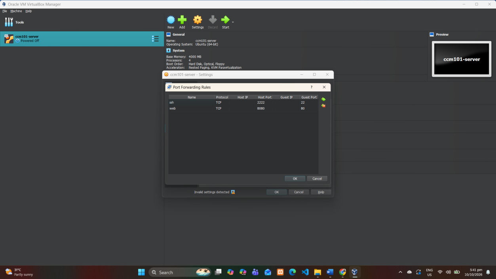

*Figure 2. Port forwarding rules*

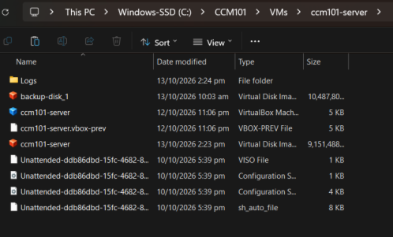

*Figure 3. VM path on the internal drive*


### 4.4 Install Ubuntu Server

Click Start, pick Try or Install Ubuntu Server and press Enter. Use these installer choices in order.

- Language English. If offered an installer update, choose Continue without updating.
- Keyboard English (US) for layout and variant. Type of install: Ubuntu Server.
- Network: keep default DHCP. Proxy: blank. Mirror: default.
- Storage: Use an entire disk, the 40 GB disk, LVM default. Review the summary, then Continue on the warning.
- Profile: your name, server name ccm101-server, a username and a password. Keep it private.
- Ubuntu Pro: Skip for now. SSH: tick Install OpenSSH server. Featured snaps: select nothing.
- When the install finishes choose Reboot Now. If it boots back into the installer, shut down the VM and remove the ISO under Settings, Storage.


### 4.5 First login and update

```bash
sudo apt update
sudo apt upgrade -y
ip addr
```

NAT usually gives the address 10.0.2.15. Figure 4 shows that this server received 10.0.2.15 on the enp0s3 interface.

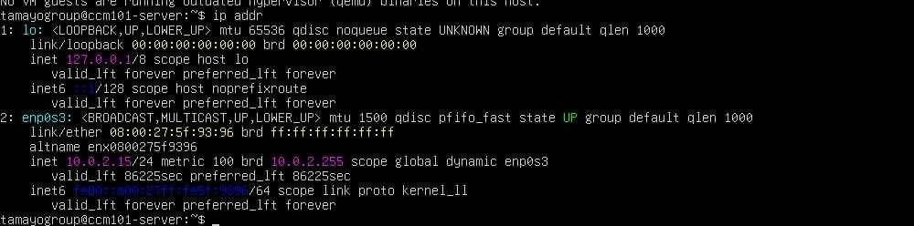

*Figure 4. ip addr output*


### 4.6 Connect with SSH from Windows

Open PowerShell on the laptop. Type yes at the fingerprint question, then enter your password. Work in this SSH window from here on so you can copy and paste.

```powershell
ssh -p 2222 tamayogroup@127.0.0.1
```

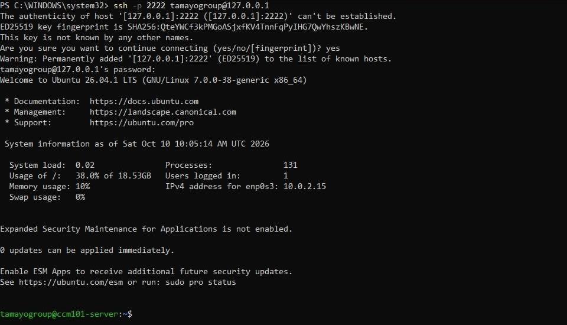

*Figure 5. SSH login*


### 4.7 Virtual backup disk

Shut the VM down with sudo poweroff. In VirtualBox select the VM, then Settings, Storage. Click the SATA controller, the Add Hard Disk icon, then Create. Choose VDI, Dynamically allocated, name it backup-disk in C:\CCM101\VMs, size 10 GB. Select the new disk, click Choose, then OK. Start the VM and SSH back in.

Find the empty 10 GB disk, usually sdb. Check the size first because formatting the wrong disk erases it.

```bash
lsblk
```

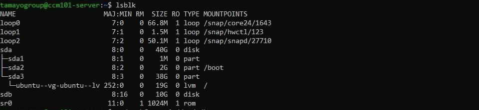

*Figure 6. lsblk output*

```bash
sudo mkfs.ext4 /dev/sdb
sudo mkdir -p /mnt/backup
sudo mount /dev/sdb /mnt/backup
sudo chown $USER:$USER /mnt/backup
sudo blkid /dev/sdb
```

Copy the UUID from the text inside the quotes after UUID=. Then make the disk mount on every boot.

```bash
sudo nano /etc/fstab
```

Add this line at the very bottom with your UUID. Save with Ctrl+O, Enter, then Ctrl+X. The UUID below is the one blkid reported for this server.

```bash
UUID=6712bdec-d0f4-4c44-b20f-82355def9307 /mnt/backup ext4 defaults,nofail 0 2
```

```bash
sudo mount -a
df -h | grep /mnt/backup
```

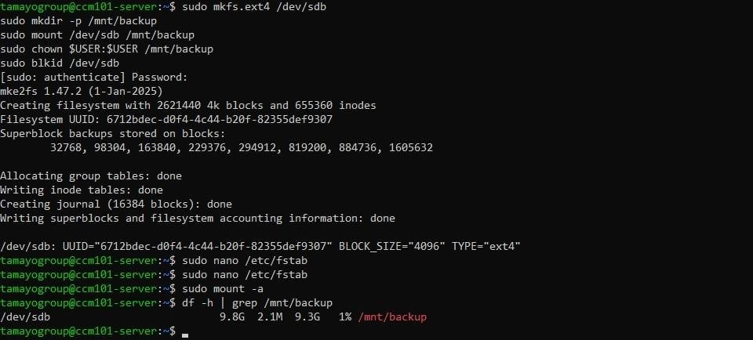

*Figure 7. Backup disk mounted*


## 5. Docker Deployment


### 5.1 Install Docker and Compose

Install from the official Docker repository.

```bash
sudo apt install -y ca-certificates curl
sudo install -m 0755 -d /etc/apt/keyrings
sudo curl -fsSL https://download.docker.com/linux/ubuntu/gpg \
  -o /etc/apt/keyrings/docker.asc
sudo chmod a+r /etc/apt/keyrings/docker.asc
echo "deb [arch=$(dpkg --print-architecture) signed-by=/etc/apt/keyrings/docker.asc] https://download.docker.com/linux/ubuntu $(. /etc/os-release && echo ${UBUNTU_CODENAME:-$VERSION_CODENAME}) stable" | sudo tee /etc/apt/sources.list.d/docker.list > /dev/null
sudo apt update
sudo apt install -y docker-ce docker-ce-cli containerd.io docker-buildx-plugin docker-compose-plugin
```

If any step fails, use this fallback. The package docker-compose-plugin does not exist in Ubuntu's own repos, so the fallback uses docker-compose-v2.

```bash
sudo apt install -y docker.io docker-compose-v2
```

The versions in Figure 8 (Docker 29.1.3 and Compose 2.40.3) carry Ubuntu package suffixes, which show this server used the fallback packages.


### 5.2 Let your user run Docker

```bash
sudo usermod -aG docker $USER
sudo systemctl enable docker
exit
```

SSH back in so the group change applies, then verify.

```bash
ssh -p 2222 tamayogroup@127.0.0.1
docker --version
docker compose version
docker run hello-world
```

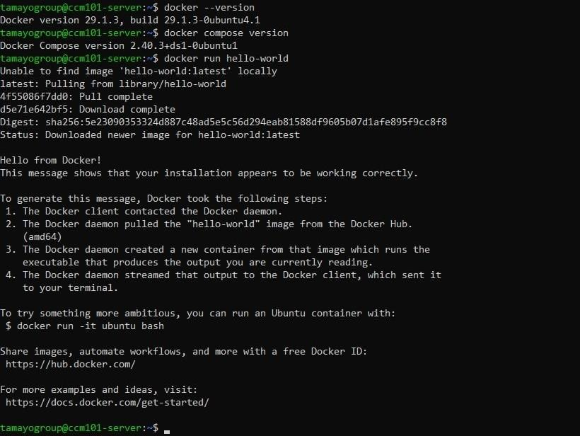

*Figure 8. Docker versions and hello-world*


### 5.3 Project folder and .env file

The .env file keeps passwords out of GitHub. Change the passwords, then save with Ctrl+O, Enter, Ctrl+X.

```bash
mkdir -p ~/ccm101-final-requirement
cd ~/ccm101-final-requirement
nano .env
```

Type these lines into the file:

```bash
MYSQL_DATABASE=wordpress
MYSQL_USER=wordpress
MYSQL_PASSWORD=ChangeMe_User123
MYSQL_ROOT_PASSWORD=ChangeMe_Root123
```


### 5.4 docker-compose.yml

Create the file with nano docker-compose.yml and paste the contents below.

```yaml
services:
  db:
    image: mysql:8.0
    container_name: ccm101-mysql
    restart: unless-stopped
    environment:
      MYSQL_DATABASE: ${MYSQL_DATABASE}
      MYSQL_USER: ${MYSQL_USER}
      MYSQL_PASSWORD: ${MYSQL_PASSWORD}
      MYSQL_ROOT_PASSWORD: ${MYSQL_ROOT_PASSWORD}
    volumes:
      - db_data:/var/lib/mysql
    networks:
      - backend
    healthcheck:
      test: ["CMD", "mysqladmin", "ping", "-h", "localhost", "-uroot", "-p${MYSQL_ROOT_PASSWORD}"]
      interval: 10s
      timeout: 5s
      retries: 10

  wordpress:
    image: wordpress:latest
    container_name: ccm101-wordpress
    restart: unless-stopped
    depends_on:
      db:
        condition: service_healthy
    ports:
      - "80:80"
    environment:
      WORDPRESS_DB_HOST: db:3306
      WORDPRESS_DB_NAME: ${MYSQL_DATABASE}
      WORDPRESS_DB_USER: ${MYSQL_USER}
      WORDPRESS_DB_PASSWORD: ${MYSQL_PASSWORD}
    volumes:
      - wordpress_data:/var/www/html
    networks:
      - backend

volumes:
  db_data:
  wordpress_data:

networks:
  backend:
```


### 5.5 Safe copy of .env for GitHub

```bash
sed 's/=.*/=CHANGE_ME/' .env > .env.example
cat .env.example
```


### 5.6 Start the stack

```bash
docker compose up -d
docker compose ps
```

Both containers should show running. The database may say healthy after about 30 seconds. In Figure 9, both ccm101-mysql and ccm101-wordpress are up and the database is healthy.


*Figure 9. docker compose ps*


### 5.7 Open WordPress

1. On the laptop, open a browser and go to http://localhost:8080.
2. Choose a language, then Continue.
3. Enter the site title Cloud Computing Application, an admin username (tamayogroup), a strong password, and your email. Click Install WordPress, then log in.
4. Create one test post (Posts, Add New, Publish). The test post is titled TAMAYO GROUP and lists the group members.

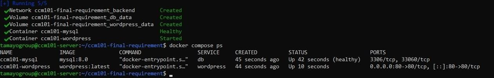

*Figure 10. WordPress site*

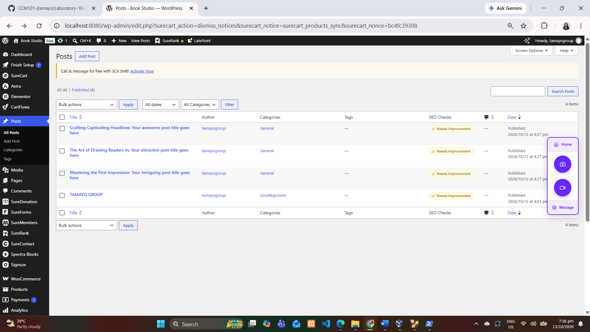

*Figure 11. Test post*


## 6. Persistent Storage and the Reboot Test

The database and WordPress files live in the Docker volumes db_data and wordpress_data. They survive container removal and VM reboots.

| Volume | Mounted in container at | Holds |
| --- | --- | --- |
| db_data | /var/lib/mysql | MySQL database files |
| wordpress_data | /var/www/html | WordPress files, themes, uploads |


### 6.1 Container restart test

```bash
docker compose down
docker compose up -d
```

Refresh the site and confirm the post is still there.


### 6.2 VM reboot test

```bash
sudo reboot
```

Wait one minute, SSH back in and run these.

```bash
docker ps
docker volume ls
df -h | grep /mnt/backup
```

Both containers should be running because of restart: unless-stopped. The volumes should be listed and the backup disk should be mounted. Docker prefixes volume names with the project folder name, so db_data and wordpress_data appear as ccm101-final-requirement_db_data and ccm101-final-requirement_wordpress_data. Refresh localhost:8080 and confirm the post survived.

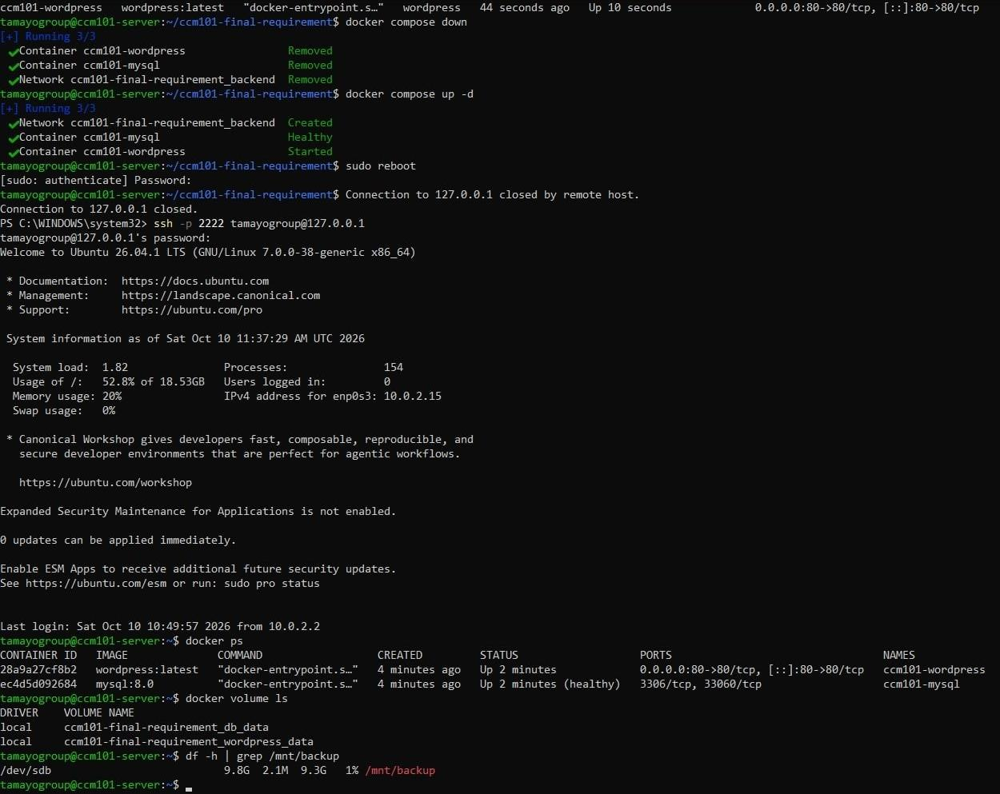

*Figure 12. Results after reboot*

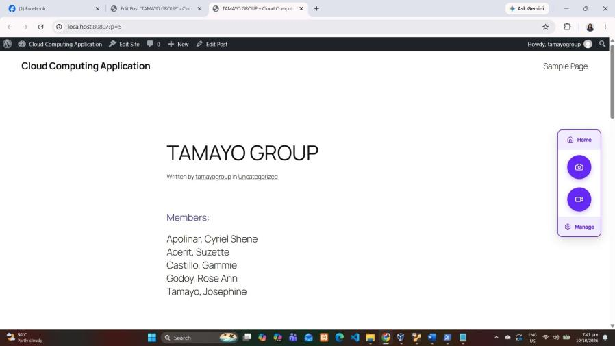

*Figure 13. Post after reboot*


## 7. Security Hardening (UFW)

UFW uses default deny for incoming traffic. Only SSH (22) and HTTP (80) are allowed. MySQL (3306) is never opened because it only talks to WordPress inside the Docker network.

```bash
sudo apt install -y ufw
sudo ufw default deny incoming
sudo ufw default allow outgoing
sudo ufw allow 22/tcp
sudo ufw allow 80/tcp
sudo ufw enable
sudo ufw status verbose
```

Type y when asked to confirm. Figure 14 shows the firewall active with default deny (incoming) and only 22/tcp and 80/tcp allowed.

| Rule | Reason |
| --- | --- |
| Default deny incoming | Everything not listed is blocked. |
| Default allow outgoing | The server can still download updates and images. |
| Allow 22/tcp | Remote administration over SSH. |
| Allow 80/tcp | Access to the WordPress site. |
| Port 3306 not opened | MySQL only talks to WordPress inside the Docker network. |

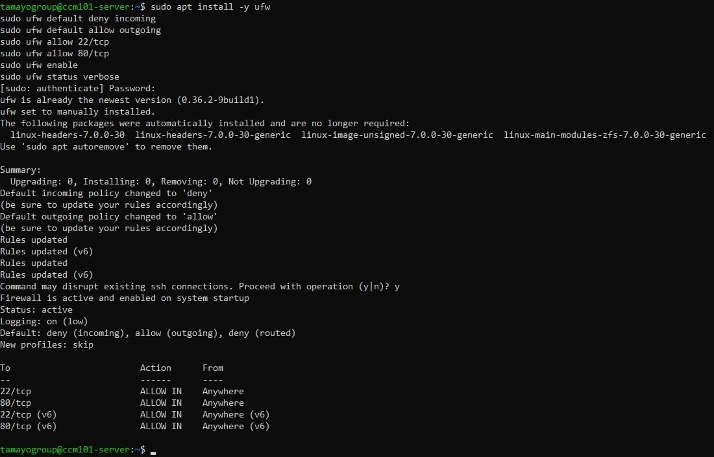

*Figure 14. UFW status*


### 7.1 Test the firewall

- Reload http://localhost:8080 and confirm the site works.
- Open a second PowerShell window and confirm ssh -p 2222 tamayogroup@127.0.0.1 still works.
- Do not run ufw allow 3306.


## 8. Backup Automation


### 8.1 The backup script

The script dumps the WordPress database to /mnt/backup, deletes dumps older than 7 days, and writes a log line. If the backup disk is not mounted, it falls back to the home folder.

```bash
cd ~/ccm101-final-requirement
nano automation-script.sh
```

```bash
#!/bin/bash

if mountpoint -q /mnt/backup; then
  BACKUP_DIR="/mnt/backup/ccm101-backups"
else
  BACKUP_DIR="$HOME/ccm101-backups"
fi

DATE=$(date +"%Y-%m-%d_%H-%M-%S")
mkdir -p "$BACKUP_DIR"

docker exec ccm101-mysql sh -c \
  'mysqldump -u root -p"$MYSQL_ROOT_PASSWORD" wordpress' \
  > "$BACKUP_DIR/wordpress_$DATE.sql"

find "$BACKUP_DIR" -name "wordpress_*.sql" -mtime +7 -delete
echo "$(date) backup saved to $BACKUP_DIR" >> "$HOME/backup.log"
```


### 8.2 Make it executable and test

```bash
chmod +x automation-script.sh
ls -l automation-script.sh
./automation-script.sh
ls -lh /mnt/backup/ccm101-backups
cat ~/backup.log
```

The ls -l output shows x in the permissions, and the backup folder contains a .sql file with a size above zero. In Figure 15 the test run created wordpress_2026-10-10_11-47-46.sql (1.2 MB) in /mnt/backup/ccm101-backups and wrote the log line.

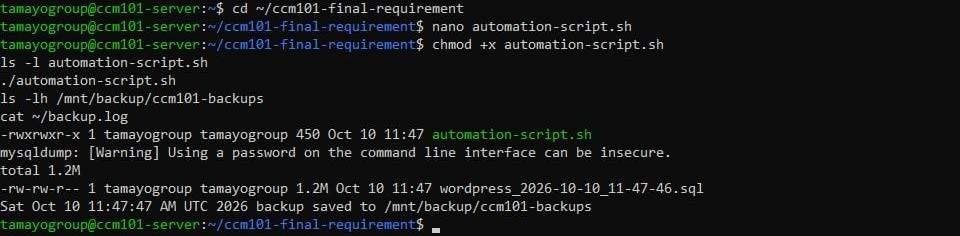

*Figure 15. Script run and backup file*


### 8.3 Schedule with cron

```bash
crontab -e
```

Choose nano if asked, then add this line at the bottom. Save, then run crontab -l to confirm.

```bash
0 23 * * * /home/tamayogroup/ccm101-final-requirement/automation-script.sh >> /home/tamayogroup/cron.log 2>&1
```

| Field | Value | Meaning |
| --- | --- | --- |
| Minute | 0 | At minute 0 |
| Hour | 23 | At 11 PM |
| Day of month | * | Every day |
| Month | * | Every month |
| Day of week | * | Every day of the week |

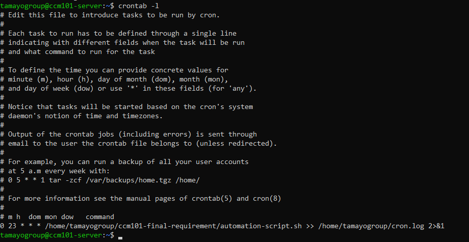

*Figure 16. crontab -l*


### 8.4 Prove that cron works

1. Run crontab -e and change the schedule part of the line to * * * * * (every minute).
2. Wait two minutes, then run the commands below.
3. Run crontab -e again and change it back to 0 23 * * *. Confirm with crontab -l.

```bash
ls -lh /mnt/backup/ccm101-backups
cat ~/cron.log
```

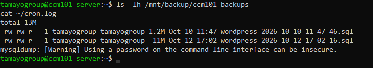

*Figure 17. Every-minute cron test*


## 9. Backup Restore Procedure

Use this to bring the WordPress database back from a saved .sql file.

1. List the available backups and choose one.
2. Run the restore. Replace FILENAME with the real backup file name, for example wordpress_2026-10-10_11-47-46.sql.
3. Refresh http://localhost:8080 and confirm your content is back.

```bash
ls -lh /mnt/backup/ccm101-backups
```

```bash
docker exec -i ccm101-mysql sh -c 'mysql -u root -p"$MYSQL_ROOT_PASSWORD" wordpress' < /mnt/backup/ccm101-backups/FILENAME.sql
```


*Figure 18. Restore procedure*


## 10. Maintenance Commands

| Command | What it shows |
| --- | --- |
| docker compose ps | Status of the two containers |
| docker logs ccm101-wordpress | WordPress container logs |
| docker logs ccm101-mysql | MySQL container logs |
| docker volume ls | Persistent volumes (db_data, wordpress_data) |
| sudo ufw status | Firewall rules |
| crontab -l | Scheduled backup job |
| df -h \| grep /mnt/backup | Backup disk is mounted |
| cat ~/backup.log | History of backup runs |


### 10.1 Safe shutdown

- Always run sudo poweroff and wait for the VM window to close before you shut down, restart or close the lid of the laptop.
- Keep the laptop plugged in while the VM runs. A sudden power loss can corrupt the VM disk.
- Keep at least 20 GB free on C: because the VM disks grow as you use them.


### 10.2 Safety copy of the VM

Run sudo poweroff, then in VirtualBox go to File, Export Appliance, select the VM, Next, and save it as C:\CCM101\VM-Backups\ccm101-server.ova. Copy the .ova to a USB drive or cloud storage too, because otherwise it lives on the same drive as the VM.


## 11. Troubleshooting

| Problem | Fix |
| --- | --- |
| Virtualization shows Disabled | Restart, enter BIOS (F2, F10, Del or Esc) and enable Intel VT-x or AMD SVM Mode. |
| VM boots back into the installer | Shut the VM down. Settings, Storage, remove the ISO from the optical drive, then start again. |
| SSH is refused on port 2222 | Check the VM is running and the ssh port forwarding rule (2222 to 22) exists. Confirm OpenSSH was installed. |
| Locked out after enabling UFW | Open the VM window directly and run sudo ufw allow 22/tcp. |
| Docker permission denied | Run sudo usermod -aG docker $USER, exit, and SSH back in. |
| docker-compose-plugin not found | Use the fallback: sudo apt install -y docker.io docker-compose-v2. |
| Site does not load at localhost:8080 | Run docker compose ps and docker logs ccm101-wordpress. Check the web rule (8080 to 80) and UFW allows 80. |
| Backup disk not mounted after reboot | Check the UUID line in /etc/fstab, then run sudo mount -a and df -h. |
| Backup file is empty | Check the db container is running and the passwords in .env are correct. |
| Cron job did not run | The VM must be on at 11:00 PM. Check crontab -l and cat ~/cron.log. |
| Data disappeared | docker compose down -v deletes volumes. Restore from a .sql backup (Section 9). |
| Port 80 busy (KillerCoda) | Change the compose port mapping to "8081:80" and open 8081. |


## 12. Conclusion

This project delivered a secure multi-tier web application. WordPress and MySQL run in separate Docker containers on an Ubuntu Server VM hosted by VirtualBox. NAT port forwarding lets the laptop reach the website and SSH. Persistent volumes keep the data safe across restarts and reboots. UFW applies default deny and exposes only ports 22 and 80, so MySQL stays private inside the Docker network. A Bash script and cron job back up the database to a dedicated virtual disk every night at 11:00 PM, and the restore procedure was practised.

Together, these steps cover virtualization, Linux and SSH, Docker and Compose, networking, persistent storage, firewall security and automation.


### Repository contents

| File | Purpose |
| --- | --- |
| README.md | Short project overview |
| architecture-diagram.png | Topology of host, hypervisor, VM, firewall, and containers |
| docker-compose.yml | WordPress and MySQL stack |
| automation-script.sh | Database backup script |
| operational-manual.md | This manual |
| final-reflection.md | Reflection from Mission 1 to Mission 10 |

